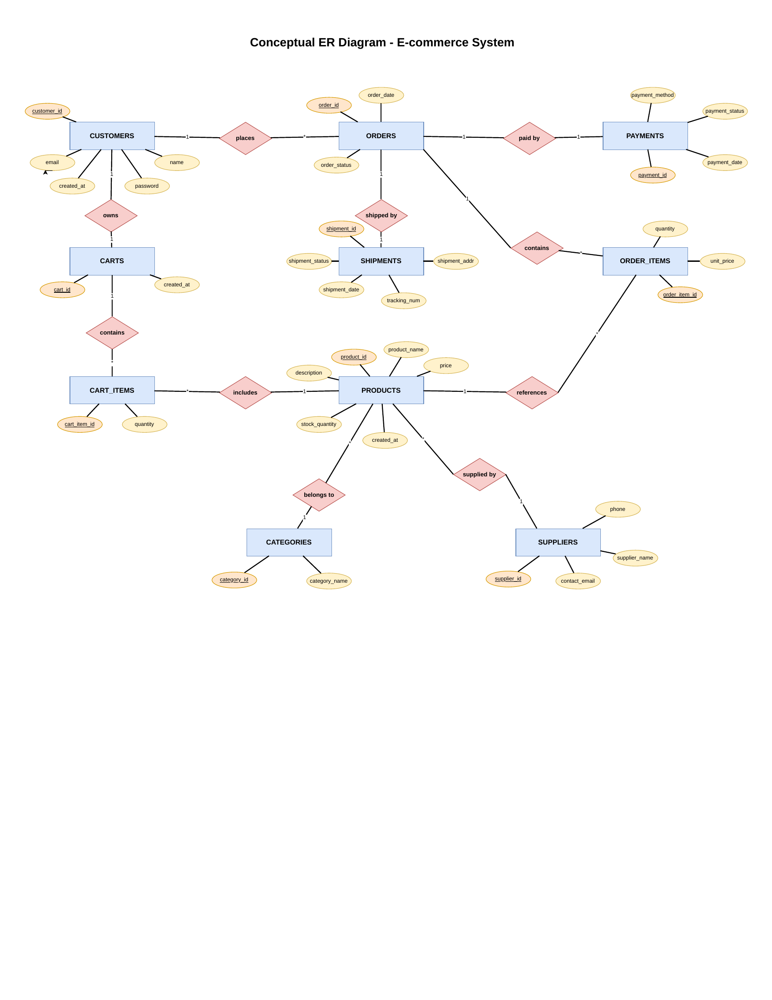

# MySQL Database Designing Project

Database design for an e-commerce system — from a conceptual ER diagram to a fully normalized logical schema.

## Conceptual ER Diagram

Entities and their relationships at a high level.

## Logical ERD

Tables, columns, data types, primary keys, foreign keys, and relationship cardinalities.

## Schema Summary

| Table | Purpose |
| --- | --- |
| `customers` | Registered users |
| `carts` | One active cart per customer |
| `cart_items` | Products inside a cart |
| `orders` | Placed orders |
| `order_items` | Products and quantities per order |
| `payments` | Payment records for orders |
| `shipments` | Shipping details and tracking |
| `products` | Catalog with price and stock |
| `categories` | Product categories |
| `suppliers` | Product suppliers |
