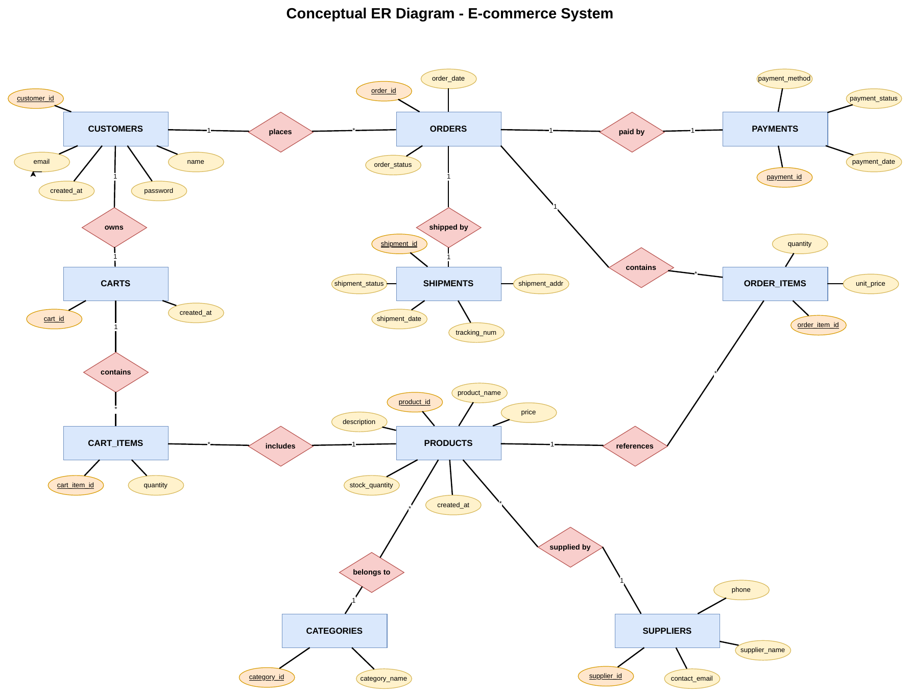
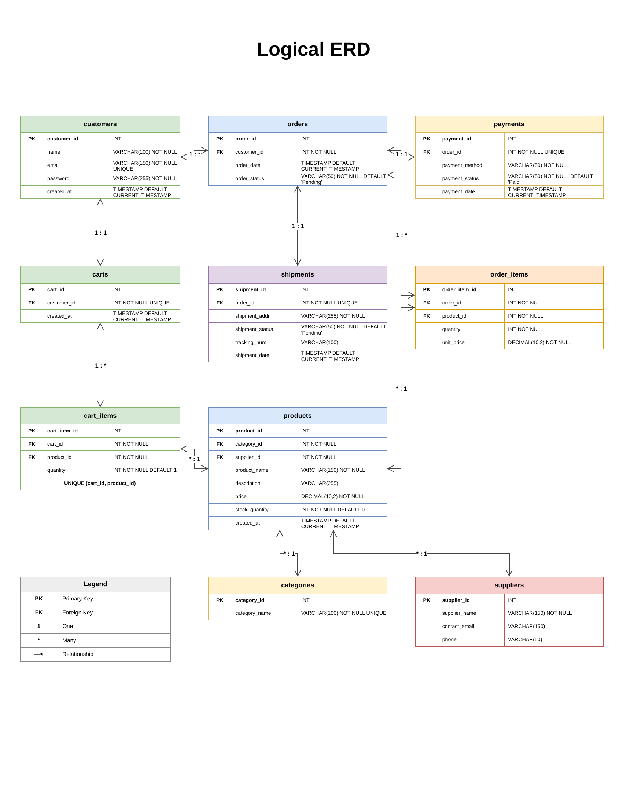

# MySQL Database Designing Project

Database design for an e-commerce system — from a conceptual ER diagram to a fully normalized logical schema.

## Conceptual ER Diagram

Entities and their relationships at a high level.

## Logical ERD

Tables, columns, data types, primary keys, foreign keys, and relationship cardinalities.

## Schema Summary

| Table | Purpose |
| --- | --- |
| `customers` | Registered users |
| `carts` | One active cart per customer |
| `cart_items` | Products inside a cart |
| `orders` | Placed orders |
| `order_items` | Products and quantities per order |
| `payments` | Payment records for orders |
| `shipments` | Shipping details and tracking |
| `products` | Catalog with price and stock |
| `categories` | Product categories |
| `suppliers` | Product suppliers |

## Relationships

| Relationship | Cardinality | How it is enforced |
| --- | --- | --- |
| `customers` → `carts` | 1 : 1 | `carts.customer_id` is a `UNIQUE` foreign key |
| `carts` → `cart_items` | 1 : \* | `cart_items.cart_id` foreign key |
| `products` → `cart_items` | 1 : \* | `cart_items.product_id` foreign key |
| `customers` → `orders` | 1 : \* | `orders.customer_id` foreign key |
| `orders` → `order_items` | 1 : \* | `order_items.order_id` foreign key |
| `products` → `order_items` | 1 : \* | `order_items.product_id` foreign key |
| `orders` → `payments` | 1 : 1 | `payments.order_id` is a `UNIQUE` foreign key |
| `orders` → `shipments` | 1 : 1 | `shipments.order_id` is a `UNIQUE` foreign key |
| `categories` → `products` | 1 : \* | `products.category_id` foreign key |
| `suppliers` → `products` | 1 : \* | `products.supplier_id` foreign key |

## Normalization

### First Normal Form (1NF)

- Every column holds a single atomic value — no comma-separated lists and no repeating groups.
- Every table has a primary key (`customer_id`, `order_id`, `product_id`, and so on).
- Multi-valued data is moved into child tables instead of being stored in one row:
  - Items in a cart live in `cart_items`, one row per product.
  - Items in an order live in `order_items`, one row per product.
- `cart_items` also has `UNIQUE (cart_id, product_id)` so the same product cannot appear twice in one cart.

### Second Normal Form (2NF)

- The schema is already in 1NF and every non-key column depends on the **whole** primary key, not part of it.
- Each table uses a single-column surrogate primary key (`*_id`), so there are no composite keys with partial dependencies.
- The composite uniqueness rule `UNIQUE (cart_id, product_id)` on `cart_items` lets `quantity` describe the exact cart + product pair rather than only the cart or only the product.
- Product details are not copied into cart or order rows; those rows reference `product_id` instead.

### Third Normal Form (3NF)

- The schema is in 2NF and there are no transitive dependencies — non-key columns do not depend on other non-key columns.
- Lookup data is stored once in its own table:
  - `category_name` lives only in `categories` (referenced by `products.category_id`).
  - Supplier details (`supplier_name`, `contact_email`, `phone`) live only in `suppliers`.
  - Customer details (`name`, `email`, `password`) live only in `customers` and are not repeated in `orders`.
- `order_items.unit_price` is intentionally a snapshot of the price at purchase time, so historical orders keep their original price even if `products.price` later changes.
- `payments` and `shipments` are separated from `orders` so payment and shipping attributes do not create partial or transitive dependencies inside the order row.
